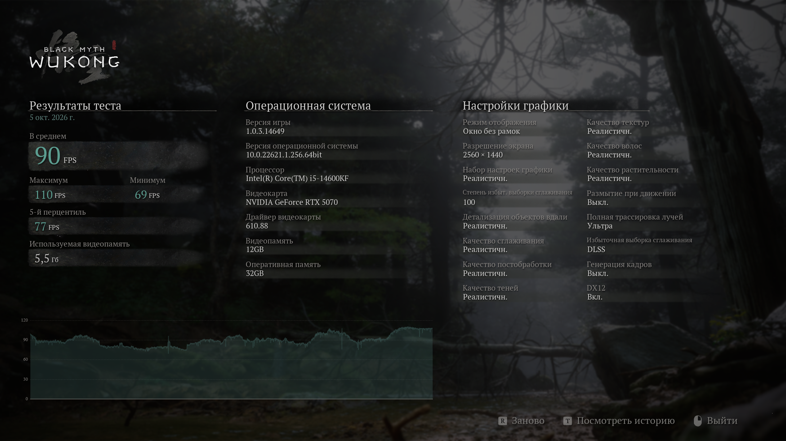

# WukongBench

C#-утилита для локального автоматического запуска двух проходов **Black Myth: Wukong Benchmark Tool** из Steam (App ID 3132990).

Одна команда применяет CPU- и GPU-профили, запускает бенчмарк, дожидается каждого результата и сохраняет HTML/JSON-отчёт. FPS считываются с итогового экрана самого Benchmark Tool; характеристики ПК — через WMI. После завершения исходные настройки восстанавливаются.

**Для проверяющего:** [пример отчёта со скриншотами](examples/README.md) · [обоснование и проверка профилей](VALIDATION.md) · [машиночитаемый результат](examples/report.json).

## Результат проверочного запуска

Intel Core i5-14600KF · NVIDIA GeForce RTX 5070 · 32 GiB RAM. Измерения от 5 октября 2026 года.

| Профиль | Средний FPS | Минимум | Максимум | 5-й перцентиль |
|---|---:|---:|---:|---:|
| CPU | 211 | 110 | 284 | 191 |
| GPU | 90 | 69 | 110 | 77 |

Профили используют разные настройки и не являются сравнением скорости CPU и GPU между собой. В контрольном CPU-проходе уменьшение разрешения с 1280×720 до 960×540 изменило средний FPS лишь с 211 до 213 (+0,95%). Подробности — в [VALIDATION.md](VALIDATION.md).



## Запуск готовой программы

Распакуйте архив `WukongBench-win-x64.zip` целиком и откройте PowerShell в папке с программой:

```powershell
.\WukongBench.exe run
```

Устанавливать .NET SDK для этой сборки не требуется. Steam, Benchmark Tool и системный OCR должны быть установлены заранее. После запуска не переключайте окна. Результат появится в `artifacts/<дата-время>/report.html`.

## Требования

- Windows 10/11 x64, Steam с выполненным входом и установленный Benchmark Tool.
- .NET 10 SDK для сборки из исходников. Для опубликованной self-contained сборки SDK не нужен.
- Русский интерфейс бенчмарка и установленный русский компонент распознавания текста Windows — это проверенная конфигурация. В коде также есть английские подписи и резервный английский OCR, но полный проход на английском интерфейсе не проверялся.
- Microsoft Visual C++ 2015–2022 Redistributable x64 для нативной библиотеки Tesseract, если его ещё нет.
- Один раз запустите бенчмарк вручную, завершите первоначальные настройки и закройте его.
- Рабочий стол должен оставаться разблокированным. Во время проходов не переключайте приложения: инструмент использует мышь, клавиатуру и снимки окна.

## Запуск из исходников

Из корня проекта:

```powershell
dotnet run --project WukongBench -c Release -- run
```

Программа сама находит библиотеки Steam, сохраняет конфигурацию, запускает CPU-проход, читает результат, закрывает приложение, запускает GPU-проход и формирует отчёты. Исходный конфиг восстанавливается в `finally`, в том числе при обычной ошибке или Ctrl+C. При аварийном завершении процесса/выключении компьютера резервная копия остаётся в папке отчёта.

```powershell
# Явный путь установки и отдельная пустая папка результатов
dotnet run --project WukongBench -c Release -- run --game-dir "D:\SteamLibrary\steamapps\common\Black Myth Wukong Benchmark Tool" --output artifacts\my-run

# Для GPU без поддержки полной трассировки
dotnet run --project WukongBench -c Release -- run --no-rt

# Отдельный проход для диагностики
dotnet run --project WukongBench -c Release -- run --profile cpu

# Контрольный CPU-проход с меньшим разрешением
dotnet run --project WukongBench -c Release -- run --profile cpu --cpu-width 960 --cpu-height 540
```

По умолчанию результат записывается в `artifacts/<дата-время>/`:

- `report.html` — читаемый отчёт с таблицей FPS, характеристиками ПК и скриншотами.
- `report.json` — машиночитаемые результаты.
- `cpu/results.png`, `gpu/results.png` — исходные экраны результатов самого бенчмарка.
- `results.txt` — исходный OCR-текст; `*-digits.png` — обработанные области с цифрами.
- `applied-settings.ini`, `effective-settings.ini` — настройки до и после запуска каждого профиля.
- `original-GameUserSettings.ini` — резервная копия пользовательских настроек.
- При ошибке: `error.txt`, `last-screen.png`, `last-screen.txt`.

## Выбор профилей

CPU-профиль использует окно 1280×720, низкое качество, отключённые полную трассировку, генерацию кадров, VSync и ограничение FPS. Снижение разрешения уменьшает графическую работу на кадр. Масштабирование дополнительно запрашивается через настройки бенчмарка; игра может ограничивать его в зависимости от выбранного апскейлера. Поэтому в отчёте отдельно сохранены запрошенные параметры, фактический конфиг и экран результата.

GPU-профиль использует исходное разрешение пользователя в режиме без рамок, максимальные уровни графики, масштаб 100%, полную трассировку высокого уровня. Генерация кадров отключена, чтобы не подменять скорость рендеринга синтезированными кадрами. Для неподдерживаемого оборудования есть `--no-rt`.

Само название «CPU» не доказывает CPU-bound режим на любом компьютере. Для проверки нужно сравнить контрольные прогоны с меньшим разрешением/масштабом и наблюдать загрузку GPU. Высокая общая загрузка всех ядер CPU не обязательна: ограничивать FPS может один поток. Не следует сравнивать результаты между компьютерами с разными GPU-профилями или версиями бенчмарка.

## Как устроена автоматизация

1. `SteamInstallation` читает реестр Steam, `libraryfolders.vdf` и манифест установленного приложения.
2. `SettingsManager` изменяет реальные поля `GameUserSettings.ini`, сохраняя неизвестные параметры.
3. `BenchmarkController` запускает Steam URI, находит процесс по полному пути и распознаёт экран приглашения, меню, подтверждение и результаты. Для каждого сценария предусмотрен тайм-аут.
4. `GameWindow` выполняет адресованный ввод и захватывает клиентскую область активного окна с учётом DPI.
5. `OcrReader` читает подписи через локальный Windows OCR. `ResultReader` выделяет цветные цифры и распознаёт их локальным Tesseract. Проверяется соотношение minimum ≤ average ≤ maximum и диапазон 5-го перцентиля.
6. `HardwareInfo` собирает CPU, GPU, драйвер и RAM через WMI; `ReportWriter` сохраняет HTML и JSON. Источником метрик FPS служит итоговый экран Benchmark Tool, а не внешний счётчик кадров.

В исследованной установке доступного текстового/CSV-экспорта результатов не обнаружено, поэтому выбран OCR. UI Automation-элементы игрового меню не используются. Изменения интерфейса, локализации или оформления цифр могут потребовать адаптации распознавания.

## Проверка и сборка

```powershell
pwsh -NoProfile -File tests\Verify.ps1
dotnet publish WukongBench -c Release -r win-x64 --self-contained true -o artifacts\release
```

Проверка использует два настоящих сохранённых экрана: 2560×1440 (111 / 95 / 127 / 99 FPS) и 1280×720 (209 / 76 / 276 / 186 FPS). Первый — контрольный пример для парсера с пользовательскими настройками, второй — исследовательский CPU-проход. Скриншоты новых измерений сохраняются отдельно в отчётах.

Опубликованную папку нужно переносить целиком, включая `tessdata` и нативные библиотеки. Запуск: `WukongBench.exe run`.

Для диагностики уже открытого окна используйте `inspect`. Чтобы перепроверить сохранённый результат без запуска игры: `parse <путь-к-results.png>`.

## Ограничения

- Не является фоновым сервисом: требуется интерактивная пользовательская сессия.
- Снимки экрана и OCR создают небольшую дополнительную нагрузку. Открытые игры, редакторы, компиляция и другие фоновые задачи тоже влияют на результат, особенно на минимум FPS.
- Не устанавливает Steam, игру, системные компоненты и драйверы.
- Не закрывает заранее запущенный пользователем бенчмарк: перед стартом сообщает об этом.
- Не отправляет результаты в интернет и не публикует репозиторий автоматически.
- При отключении питания восстановите конфиг вручную из резервной копии после закрытия бенчмарка.

Лицензии сторонних компонентов перечислены в `THIRD-PARTY-NOTICES.md`.

Результаты реального запуска, контроль CPU-профиля и проведённые проверки описаны в [VALIDATION.md](VALIDATION.md).

## Структура репозитория

```text
WukongBench/             приложение на C# и модель OCR
tests/                  проверки на настоящих скриншотах
examples/               пример HTML/JSON-отчёта, настройки и скриншоты
README.md               возможности, требования и запуск
VALIDATION.md           методика и результаты проверки
THIRD-PARTY-NOTICES.md   сторонние компоненты и лицензии
SUBMISSION.md           публикация и текст ответа для сдачи
WukongBench.slnx         решение .NET
```

В `examples` опубликована копия реального отчёта: из конфигов удалён идентификатор монитора, резервная копия пользовательских настроек не включена. Исходные скриншоты, FPS и OCR-текст сохранены без изменений. HTML-пример открывается локально после скачивания репозитория; для просмотра непосредственно на GitHub предусмотрен [Markdown-отчёт](examples/README.md).
