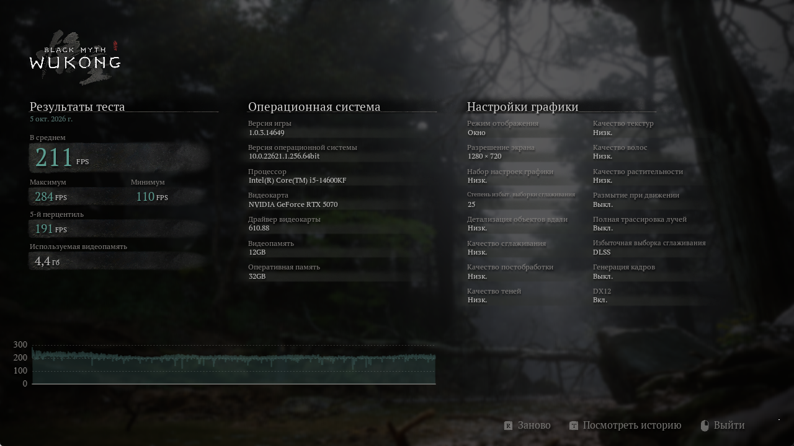
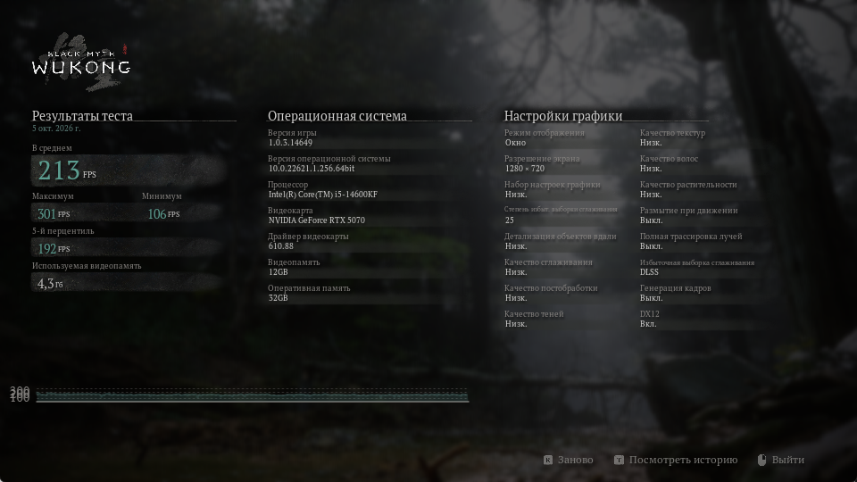

# Отчёт о проверочном запуске

**Black Myth: Wukong Benchmark Tool · 5 октября 2026 года**

Одна команда автоматически выполнила CPU- и GPU-проходы. Метрики распознаны с итоговых экранов самого бенчмарка. После выполнения исходные настройки восстановлены; совпадение файлов проверено по SHA-256.

[HTML-версия для локального просмотра](report.html) · [исходный JSON](report.json) · [методика и проверки](../VALIDATION.md)

## Компьютер

| Компонент | Характеристика |
|---|---|
| CPU | Intel Core i5-14600KF, 14 ядер / 20 потоков |
| GPU | NVIDIA GeForce RTX 5070, 12 GB видеопамяти |
| RAM | 32 GiB |
| ОС | Windows, build 22621 |
| Драйвер GPU | 610.88; WMI: 32.0.16.1088 |
| Benchmark Tool | 1.0.3.14649, Steam build 15365379 |

## Результаты

| Проход | Средний FPS | Минимум | Максимум | 5-й перцентиль |
|---|---:|---:|---:|---:|
| CPU | **211** | 110 | 284 | 191 |
| GPU | **90** | 69 | 110 | 77 |

Результаты относятся к разным наборам настроек. Отношение этих значений не показывает относительную скорость процессора и видеокарты.

## Настройки и обоснование

| Параметр | CPU | GPU |
|---|---|---|
| Разрешение | 1280×720 | 2560×1440 |
| Режим окна | Окно | Без рамок |
| Масштаб рендера | 25% | 100% |
| Качество графики | Низкое | Максимальное, «Реалистичн.» |
| Полная трассировка | Выкл. | Ультра |
| Генерация кадров | Выкл. | Выкл. |
| VSync / лимит FPS | Отключены в конфиге | Отключены в конфиге |

**CPU:** снижение разрешения и качества уменьшает графическую работу на кадр. Контрольный проход 960×540 с тем же качеством дал 213 FPS вместо 211: при уменьшении числа выходных пикселей на 43,75% средний FPS вырос на 0,95%. Это поддерживает выбор профиля на данном ПК; для другого оборудования требуется отдельная проверка.

**GPU:** исходное разрешение пользователя, масштаб 100%, максимальная графика и полная трассировка увеличивают нагрузку на видеокарту. Разовое наблюдение во время прохода показало загрузку GPU 99%; усреднённая телеметрия не собиралась.

Генерация кадров отключена в обоих проходах. В фоне оставались пользовательские приложения, а захват экрана и OCR создавали дополнительную нагрузку. Это проверка работоспособности и выбора профилей, а не лабораторное сравнение оборудования.

## Исходные материалы

| Проход | Скриншот | OCR | Применённые настройки | Настройки после прохода |
|---|---|---|---|---|
| CPU | [PNG](cpu/results.png) | [TXT](cpu/results.txt) | [INI](cpu/applied-settings.ini) | [INI](cpu/effective-settings.ini) |
| GPU | [PNG](gpu/results.png) | [TXT](gpu/results.txt) | [INI](gpu/applied-settings.ini) | [INI](gpu/effective-settings.ini) |

Из публичных копий INI удалён идентификатор монитора. JSON, OCR-текст и изображения сохранены без изменений; в необработанном OCR возможны ошибки в названиях оборудования. Резервная копия пользовательской конфигурации не включена.

### CPU-проход

### GPU-проход

### Контроль CPU-профиля

960×540: средний FPS **213**, минимум **106**, максимум **301**, 5-й перцентиль **192**. [Исходный JSON](control-cpu/report.json).

